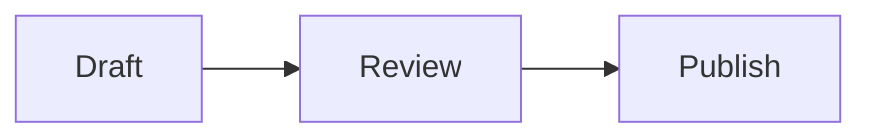

[](https://github.com/versyxdigital/mkeditor/actions/workflows/tests.yml) &nbsp;&nbsp;&nbsp;&nbsp;[](https://github.com/versyxdigital/mkeditor/actions/workflows/github-code-scanning/codeql)

# MKEditor

Markdown with _style_.

| Platform    | Stable  | Download  |
| --------    | ------- | -------   |
| Windows     | v4.1.0  | [exe](https://github.com/versyxdigital/mkeditor/releases/download/v4.0.0/mkeditor-setup-4.1.0.exe) |
| MacOS       | v3.6.0  | [pkg](https://github.com/versyxdigital/mkeditor/releases/download/v3.6.0/mkeditor-setup-3.6.0.pkg) |
| Linux       | v4.1.0  | [deb](https://github.com/versyxdigital/mkeditor/releases/download/v4.0.0/mkeditor-setup-4.1.0.deb)  |

Download for desktop or use it directly through your [browser](https://versyxdigital.github.io/mkeditor/web/). More documentation is available at the [website](https://versyxdigital.github.io/mkeditor).

<p>
    
    
</p>

## Contents

- [Welcome](#welcome)
  - [Create alerts](#create-alerts)
  - [Format code](#format-code)
  - [Write math](#write-math)
  - [Draw diagrams](#draw-diagrams)
  - [Preview documents as you type](#preview-documents-as-you-type)
  - [Customize to your preference](#customize-to-your-preference)
  - [Export to HTML & PDF](#export-to-html--pdf)
  - [Enable AI assistance](#enable-ai-assistance)
- [Contributing](#contributing)
- [License](#license)

# Welcome

Thank you for choosing MKEditor 😊, I hope you find this tool useful for all your markdown needs!

If you have any issues or questions, please feel free to submit an [issue](https://github.com/versyxdigital/mkeditor/issues).

MKEditor fully supports the [CommonMark](https://commonmark.org/) spec and comes with additional goodies.

## Create alerts

```sh
::: primary
✨ Create alerts
:::
```


## Format code

```javascript
document.addEventListener('DOMContentLoaded', () => {
    document.body.write('Syntax-highlighted codeblock!')
})
```

Syntax highlighting is supported for lots of languages!

## Draw diagrams

Write a fenced `mermaid` block, or choose Mermaid from the code-block menu. Diagrams render in the document preview on desktop and web, and are included in HTML and PDF exports. HTML exports embed the diagrams as SVG.

````markdown

````

Flowcharts, sequence diagrams and Mermaid's other diagram types use the same renderer as AI responses. Invalid or unfinished diagrams stay visible as code while you edit.

## Write math

```sh
$\sqrt{3x-1}+(1+x)^2$
```

$\sqrt{3x-1}+(1+x)^2$

MKEditor comes with full support for writing expressions with LaTeX!

## Preview documents as you type

MKEditor includes a built-in, fully configurable, resizable preview renderer. View your styled or unstyled output in real time.

## Customize to your preference
Customize your settings, enable word-wrapping, toggle automatic indentation, switch between light mode or dark mode, enable workspace persistence and more.

## Export to HTML & PDF

MKEditor comes with full support for exporting your markdown to HTML and PDF 🚀.

## Enable AI assistance

MKEditor v4.0.0 comes with the ability to connect to your AI provider of choice 🤖 Choose between Anthropic, OpenAI, or a local Ollama install. Each provider gets its own chat tab with persisted conversation history and a workspace-aware tool catalog: the assistant can read, edit, and create files in your open folder (write actions ask you to confirm first).

On desktop, OpenAI also supports your ChatGPT subscription: open **Settings → AI Providers → OpenAI**, choose **ChatGPT plan**, and select **Continue with ChatGPT**. Complete sign-in and grant plan access in your browser, then return to MKEditor. Eligible requests share your ChatGPT plan's limits. **Manage usage** opens ChatGPT's settings. You can switch back to **API key** explicitly; MKEditor never falls back to API billing automatically. Anthropic continues to use API-key authentication.

> [!IMPORTANT]
> API keys are encrypted with Electron's `safeStorage` and are never transmitted through the app in plaintext.

## Google Drive (experimental)

Desktop builds can connect through **Settings → Connections → Connect with Google**, browse My Drive/shared drives and open Markdown files. Connections start read-only; **Enable editing** separately authorizes conditional saves and new Markdown files in My Drive. Conflict comparison, explicit reload, unknown-result checks and local-copy recovery protect open buffers. Shared-drive writes remain disabled. The write protocol passed a live disposable-file check; the positive Windows consent/browse/save/create flow was recorded, while remaining live smoke checks and Google's public-app verification are pending. See the [setup guide](docs/cloud/google-drive.md) and [maintainer consent guide](docs/cloud/google-verification.md). Other adapters remain planned.

## Dropbox

Connect Dropbox in **Settings → Connections**, browse existing folders, edit Markdown, create files and save copies. Conditional saves protect external edits, and encrypted recovery retains unsaved drafts across restart. The core workflow has passed a live Windows test. See [Dropbox setup and scope](docs/cloud/dropbox.md).

# Contributing

Developer documentation can be found [here](./CONTRIBUTING.md).

# Privacy

The [privacy policy draft](docs/privacy.html) describes local storage and optional Google Drive, Dropbox and AI connections. It is prepared for publication on MKEditor's website; the [maintainer guide](docs/cloud/google-verification.md#prepared-privacy-page) explains deployment and Google consent configuration.

# License

MKEditor is open source software licensed under the [MIT License](./LICENSE).


Built with ❤️ by [Versyx Digital](https://github.com/versyxdigital)
