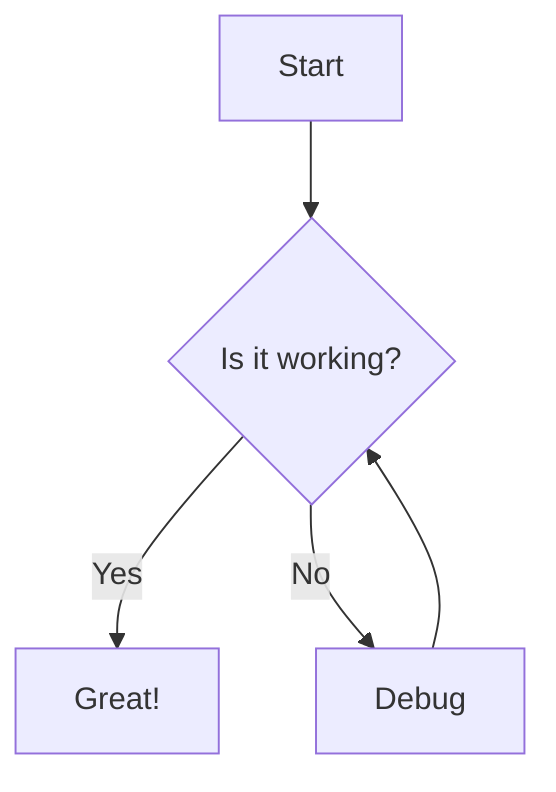
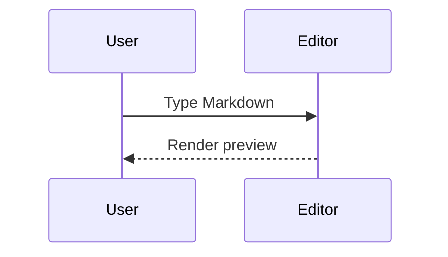

# Markdown renderer test

Jump to [Lists](#lists), [Code](#code), [Tables](#tables), or [Extras](#extras).

## Headings

# Heading 1

## Heading 2

### Heading 3

#### Heading 4

##### Heading 5

###### Heading 6

## Text formatting

Plain text, **bold text**, _italic text_, _**bold and italic**_, ~~strikethrough~~, and `inline code`.

Mixed: **bold with _nested italic_ inside**. Escaped: \*not italic\*, \# not a heading.

H<sub>2</sub>O and E = mc<sup>2</sup>. <kbd>Ctrl</kbd> + <kbd>S</kbd>, <mark>highlighted text</mark>, <u>underlined text</u>.

A line with two trailing spaces  
creates a hard line break.

Unicode: café, naïve, 日本語, Ελληνικά, العربية, 😀 🚀 🌻 ✅ ❌.

## Blockquotes

> A simple blockquote.

> A multi-line blockquote
> that continues onto a second line.
>
> A second paragraph.
>
> > Level two
> >
> > > Level three
>
> Back to level one.

> **Quote with formatting**
>
> - A list inside a quote
> - Another item
>
> ```js
> console.log('code inside a quote');
> ```

## Lists

### Unordered

- Item one
- Item two
  - Nested item 2a
  - Nested item 2b
    - Deeply nested 2b-i
    - Deeply nested 2b-ii
- Item three

### Ordered

1. First
2. Second
3. Third
   1. Sub-item one
   2. Sub-item two
4. Fourth

### Mixed

1. Ordered parent
   - Unordered child
   - Another child
2. Second parent
   1. Ordered child
   2. Another ordered child

### Task lists

- [x] Write the test document
- [x] Paste it into the chat
- [ ] Verify headings render
  - [x] Verify simple tables
  - [ ] Verify wide tables

### Loose lists

- First item with a paragraph.

  A second paragraph within the first item.

- Second item

  ```bash
  echo "code inside a list item"
  ```

- Third item.

## Code

Inline: use `git status` to check, or `const x = 42;` in JavaScript.

```javascript
function fibonacci(n) {
  if (n <= 1) return n;
  return fibonacci(n - 1) + fibonacci(n - 2);
}
console.log('café 日本語 😀');
```

```json
{ "name": "Renderer test", "tags": ["test", "markdown"], "enabled": true }
```

```css
.container > .item:hover::after {
  content: '→';
  color: rgb(255 0 128 / 50%);
}
```

```sql
SELECT u.name, COUNT(o.id) AS orders
FROM users u
LEFT JOIN orders o ON o.user_id = u.id
GROUP BY u.name
HAVING COUNT(o.id) > 5;
```

```diff
- removed line
+ added line
  unchanged line
```

```
Plain preformatted text.
    Indentation   and   spacing
are preserved exactly.
```

    An indented block
        keeps its whitespace too.

## Tables

| Item   | Amount |     Notes      |
| :----- | -----: | :------------: |
| **Q4** |   9 GB | Escape \| pipe |
| Q8     |  16 GB | `inline code`  |

| ID  | First | Last    | Email              | Phone    | Street         | City   | Country |
| --- | ----- | ------- | ------------------ | -------- | -------------- | ------ | ------- |
| 1   | Alice | Example | alice@example.test | 555-0101 | 1 Example Road | London | UK      |
| 2   | Bob   | Jones   | bob@example.test   | 555-0102 | 2 Low Road     | London | UK      |

## Links and images

[Example](https://example.com), [Hover me](https://example.com 'A link title'), <https://example.com>, https://example.com/bare.

[Reference link][example]. [Back to Lists](#lists).

[example]: https://example.com 'Reference title'


---

## Extras

### HTML blocks

<details>
<summary>Click to expand this collapsible section</summary>

Hidden content with **Markdown inside**, and a list:

- One
- Two
- Three

</details>

<div style="padding: 1em; border: 2px dashed #888; border-radius: 8px">

A styled <strong>HTML panel</strong>.

</div>

<!-- This comment must not be visible. -->

### Footnotes

Here is a sentence with a footnote.[^1] And another.[^note]

[^1]: This is the first footnote.

[^note]: This is a named footnote with more text.

### Math

Inline math: $E = mc^2$ and $a^2 + b^2 = c^2$.

$$\int_{-\infty}^{\infty} e^{-x^2}\,dx = \sqrt{\pi}$$

$$\sum_{n=1}^{\infty} \frac{1}{n^2} = \frac{\pi^2}{6}$$

### Mermaid diagrams





### Alerts

> [!NOTE]
> Useful information that users should know.

> [!TIP]
> Helpful advice for doing things better.

> [!IMPORTANT]
> Key information users need to know.

> [!WARNING]
> Urgent info that needs immediate attention.

> [!CAUTION]
> Advises about risks or negative outcomes.

### Emoji shortcodes

:smile: :rocket: :sunflower: :tada: :warning:

### Stress tests

- Level 1
  - Level 2
    - Level 3
      - Level 4
        - Level 5
          - Level 6

https://example.test/a-very-long-path-without-spaces/aaaaaaaaaaaaaaaaaaaaaaaaaaaaaaaaaaaaaaaaaaaaaaaaaaaaaaaaaaaaaaaaaaaaaaaaaaaaaaaaaaaaaaaaaaaaaaaaaaaaaaaaaaaaaaaaaaaaaaaaaaaaaaaaaaaaaaaaaaaaaaaaaaaaaaaaaaaaaaaaaaaaaaaaaaaaaaaaaaaaaaaaaaaaaaaaaaaaaaaaaaaaaaaa

```text
This is a very long line that should scroll horizontally without expanding the chat pane: aaaaaaaaaaaaaaaaaaaaaaaaaaaaaaaaaaaaaaaaaaaaaaaaaaaaaaaaaaaaaaaaaaaaaaaaaaaaaaaaaaaaaaaaaaaaaaaaaaaaaaaaaaaaaaaaaaaaaaaaaaaaaaaaaaaaaaaaaaaaaaaaaaaaaaaaaaaaaaaaaaaaaaaaaaaaaaaaaaaaaaaaaaaaaaaaaaaaaaaaaaaaaaaaaaaaaaaaaaaaaaaaaaaaaaaaaaaaaaaaaaaaaaaaaaaaaaaaaaaaaaaaaaaaaaaaaaaaaaaaaaaa
```

Special characters: & < > " ' © ™ § ¶ † ‡ • … — « » ¿ ¡.

_End of test document. If you can read this, the renderer made it all the way through._
